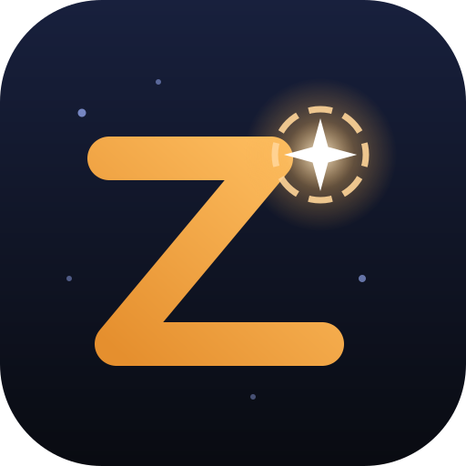

<p align="center"></p>

# Zenigo

Push-to for your telescope.

A web app that works out where a Dobsonian telescope is pointing using the phone camera, then guides you to the chosen object with azimuth and altitude arrows. The phone is mounted parallel to the tube. The app detects the stars in the camera image, matches them against a star catalogue (plate solving) and converts the direction into altitude/azimuth using time and location.

Everything runs locally in the browser: no server, no sign-in. The website lives at `/` (landing page, `/getting-started/`, `/help/`, `/diy-accessories/`, `/privacy/`, `/imprint/`), the app at `/app/`: a small HTML page (with a start screen that shows at once) and four scripts named by their content (Astronomy Engine, satellite.js, catalogue + solver, app; about 700 KB together), loaded with `defer` so the browser compiles them in the background. Fonts are self-hosted, so no page contacts third parties. It is an installable web app (PWA) and works offline once it has been opened: add it to the home screen before heading out to a dark site without signal. When a new version has been deployed, the app shows a notice with an **Update** button; it can be dismissed, and the old version keeps working until you update.

## Usage

1. Serve the app over HTTPS; browsers only allow camera, GPS and motion sensors there. The repo is connected to Cloudflare: every push to `main` builds and deploys automatically (`npx wrangler deploy` runs `npm run build` first, see `wrangler.jsonc`). Sync between devices also needs a D1 database, created once in the EU (`npx wrangler d1 create zenigo-sync --jurisdiction eu`) and bound as `SYNC_DB` in `wrangler.jsonc`; until then the app hides sync.
2. Mount the phone firmly and parallel to the tube, start the camera and tap **Locate**. The first time, the app measures the camera's field of view and remembers it.
3. Centre a bright star in the eyepiece, tap **Eyepiece point** and tap the same star in the image. Now the app knows the offset between phone and telescope.
4. Choose a target (Sun, Moon, planets, Messier objects, bright stars) and follow the arrows, with **Continuous** for live updates. After the first solve, Continuous only checks the predicted orientation (from the last solve plus the gyroscope) against the stars, which takes milliseconds; it falls back to a full search when the prediction does not fit.

**Camera button:** while the live camera runs, a tap stops it; otherwise a small menu offers Live camera, **Night photo** (an `<input capture>` that opens the camera app, whose night mode exposes for seconds; the solved photo becomes the motion-sensor base like a live Locate, with the device orientation read right after returning, and is pinned to the sky) and Photo from the gallery. Both photo ways are also in Quick settings.

**Stacking:** live Locate averages 24 frames by default (up to 90) as floating point and tells the detector the lower noise floor (0.5/√n grey levels instead of 0.5); the gyroscope (tolerance about 2 px, from the field of view) skips frames taken while the telescope moves and restarts only if it ends up pointing elsewhere early (late: uses the frames so far). On a synthetic low-noise stream this found 75 → 104 → 110 of 120 faint stars for 6 / 24 / 60 frames (the old fixed floor stuck at 49). Continuous uses a third of the frames.

**Diagnostics** (Settings › Camera & sensors, off by default): each Locate keeps its stack, the first single frame and the numbers; a tap on the status opens a sheet with image layers (stack, raw, sky removed, detection mask, one frame; tap to zoom; the stack and one frame are shown above the local sky background, and the numbers give the centre-to-corner sky gradient), detected points and matched stars, a histogram with sky level and threshold, capture/camera/noise/FWHM/result figures, the last ten attempts, and Save (the selected layer, with marks if on, as PNG + JSON report via the share sheet or downloads; "One frame" only for live captures) / Copy report. While the live camera runs, a quick detection on a 480-px frame every 1.5 s shows points, sky, noise and star size.

**Photo from the gallery** (camera button or Quick settings) solves saved sky photos, which is handy for testing. A solved photo (without Align) can be explored like the map: drag turns the view around it, pinch or wheel zooms out, the photo is bent onto the sky with a mesh warp: grid points go photo pixel → sky (its own solution incl. lens distortion) → view, drawn with WebGL (32×24 grid, one copy onto the map; skipped for software WebGL and dropped after slow frames) or else with 2D-canvas triangles (16×12 at rest, 8×6 while dragging, density lowered on slow frames). Measured on an 80° synthetic photo: stars at the photo edges within about 0.5 px of the map (the former affine placement was 6–10 px off). Double tap returns to the photo. Loading a photo turns Align off; turning Align on again switches back to the sky map, aimed where the photo pointed, and a solved photo stays pinned to its stars there (same mesh warp). A chip shows it: tap to find it (turns the free map to it, or says which way to turn the phone), × removes it. Loading another photo replaces it.

**Layout:** the menu button (logo + ☰, on tablets and computers with the word “zenigo”) sits top left, the target line next to it. On tablets and computers (≥ 900 × 500 px) the menu, the logbook with its entries and Seen, and the settings open as a panel on the left (logbook and settings have a back arrow to the menu), all other sheets (details, target, search, list, filter, quick settings) on the right; the menu no longer has filter, sky map or gallery entries (buttons and quick settings cover them), and the position numbers (target RA/Dec, field of view, accuracy, stars matched) are an optional box at the top right below the target line: one short line (field of view, accuracy, matched stars), tap to expand (remembered) for location and its source (GPS ± accuracy and time, entered, default; `cfg.loc`) and the telescope's RA/Dec/alt/az; On the map › Position numbers, off by default; the right panel stays open after actions inside it (set/remove target, quick targets, list Next, Seen, photo buttons) and only ✕ or Esc close it. From 1000 px width the menu and a right panel stay open side by side; the menu has its own narrower width (max 360 px), so the right panel never changes size. Phones keep bottom sheets that close after an action.

**Button column:** measured against the directions, the position box and the menu button at the top (`layoutFabs`, on resize and whenever the HUD or the buttons change): if it would reach into them, the buttons get smaller (`compact`), then go into two columns (`two`).

**Pills bottom left**: the current target with its state (distance, in the eyepiece, below the horizon, next satellite pass; tap: target panel, ✕: clear it; replaces the line under the directions), “Next” on the plan, the compass correction (✕ removes it; after aligning on the map in compass mode it also restores the eyepiece point from before, `cfg.calTeleBak`), the photo on the sky, filter and time.

**Quick settings** (top round button) holds what you change at the telescope, most used first: eyepiece and eyepiece view, eyepiece point and compass correction (one-tap reset), red light, solve a photo, camera and mirrored image, pointing, map labels, button labels, and the location as one line with GPS and Edit. **Settings → Camera** can switch to another camera, e.g. a USB webcam on the tube; field of view and eyepiece point are kept per camera. **Settings → Pointing → Top edge** uses the phone's top edge as the pointer without any camera (compass and gyroscope only); the map stays upright there (zenith up, however the phone is held or rolled), and with a periscope mirror the camera image is flipped top to bottom so it matches; "I'm pointing at it" in an object's details aligns the compass on a bright star.

**Telescope and eyepieces** (Settings): telescope focal length and aperture, eyepieces (focal length, apparent field), Barlow lens and finder type (see below). The map can show Telrad rings (0.5°/2°/4°) and the true field of the selected eyepiece and the finder around the crosshair; an **eyepiece view** at the bottom left shows the field as it looks in the eyepiece (zenith up, turned upside down for a Newtonian, mirrored for a star diagonal, plus a fine rotation), with the target or an arrow towards it. The selected eyepiece is in Quick settings, and "should be in the eyepiece" uses its true field.

**Finder** (Settings → Telescope, `optics.finderType`, `optics.finderOrient`): red-dot/LED, Telrad (turns on the Telrad rings), 6×30 (7°), 8×50 (6°), 9×50 (5.5°, straight or right-angle correct image) or other (field entered); old settings migrate (6° → 8×50, else other). Red-dot and Telrad have no optical field: the map shows a red dot at the crosshair (red-dot) or the Telrad rings, and the eyepiece view's finder mode is a naked-eye view (8° / 10°, upright, no 6–9 mag stars or NGC) with the dot or the rings; switching away from the Telrad turns its rings off. The finder has its own image orientation in the eyepiece view (no fine rotation). The eyepiece view has a gear to the telescope settings; the eyepiece advice starts its tip with “Aim with the … finder”.

**Barlow lens** (Settings → Telescope, `optics.barlow`, `optics.useB`): an eyepiece with a Barlow is treated as one with focal length ÷ factor and the same apparent field (`withBarlow`, `epCombos`), so magnification, true field, exit pupil, map rings, eyepiece view, quick select (`i:b` keys), log and advice all include the combinations; the advice adds a small penalty so the eyepiece alone wins when about as good.

**Best eyepiece** (details and target panel; `epAdvice`, `fillEpBox`): with the aperture (Settings; without it or without eyepieces the box shows a note with a link to Settings → Telescope) the app knows each eyepiece's exit pupil and the highest useful magnification (2× aperture in mm). For deep-sky objects it scores framing (catalogue size ÷ true field against a wanted fill per type) and exit pupil against a wanted value per type (galaxies/nebulae ~3 mm, globulars ~1.5 mm, planetary nebulae ~1.2 mm, open clusters mostly framing); the Moon gets the highest magnification that still shows the whole disc plus a detail tip; planets a magnification relative to the aperture, capped at 150–280× for seeing. The box shows the best one with the reason, all eyepieces with a verdict (tap = show its reason above, "Use it" = make it the eyepiece in use), and "find it with the widest, then switch".

**Deeper catalogue:** zoomed in, the map shows stars down to magnitude 9 and NGC/IC objects (about 1,900, galaxies to 12 mag, others to 11.5 mag), more the further you zoom in; large objects are drawn at their true size. They are searchable as targets ("NGC 869", "North America Nebula") and can be switched off in the filter ("Beyond Messier"). Locate still matches against the stars to magnitude 6.

**Current target** (Target button, or tap the target line in the HUD): a panel with turn/tilt from the crosshair, altitude and direction now, tonight's visibility bar (sunset to sunrise: amber = above the horizon, green = well placed, above 20° in darkness, red tick = now), planned/starred/seen state, details (magnitude, size or distance, eyepiece field, RA/Dec, history) and links, and buttons for Seen, Next, Plan, star, change and clear; also shown at the top of the observing list.

**Observing list and logbook:** objects can be *starred* (wish list, some day), *planned* (tonight) and *seen* (logbook). The details have a star toggle and "Plan"; their main buttons (Seen, Set as target, Plan) and the target panel's Seen/Next stay at the bottom while the content scrolls. Find target has star and plan as icons. The List button (to-do count) opens tabs Planned (sorted by when objects get low, with type, magnitude, best time, the altitude now and a bar for the night; tap = target, ✕ = unplan; "Next" also next to the target in the HUD), Seen tonight (✕ deletes tonight's entry) and Starred (well placed tonight first, plan icon). "Seen" creates a log entry with date, eyepiece, altitude, Moon and site filled in, plus easy/hard/not found, seeing and transparency 1–5 and a note; seeing a starred object removes its star; "Save, next" goes on through the plan. The logbook (menu) shows progress, suggests unseen Messier objects for tonight, lists entries by night; an opened entry has back and newer/older navigation and keeps edits. Backup lives only in Settings → General → Backup and restore: back up the lists (list, starred, logbook) or lists and settings (incl. telescope and eyepieces) as JSON; restoring merges missing entries and asks before replacing settings; logbook also as CSV. Settings are grouped in tabs General / Telescope / Camera & sensors. Map marks: amber flag = planned, star outline = starred, green tick = seen. Stored in localStorage (`zenigo-obs`).

**Milky Way** (filter extra, off by default, `cfg.show.mw`): outlines in five brightness steps from the Milky Way Outline Catalog (J. R. Vieira) via d3-celestial (BSD-3-Clause), converted by `scripts/milkyway.mjs` to `public/app/milkyway.json` (37 KB, loaded when first switched on, precached). Each level is filled with low alpha (even-odd); rings are clipped against a circle in front of the view and the chains joined round it, with each ring's inside decided geometrically (small rings: their small side; the two band edges: the north galactic pole's side), not by winding.

**Pointing in the HUD:** without a target the boxes show the telescope's azimuth/altitude (when tracking); with a target a tap toggles between the deltas and the absolute values (`cfg.hudAbs`).

**Decluttering:** the pills bottom left hide behind a tab at the left edge (`cfg.cornerAway`, red dot with a target); hints have a ✕.

**Setup assistant** (`wiz*`): a card at the bottom left (crosshair in the middle stays visible). Opens when Locate is tapped before Align is on or before an eyepiece point was ever set (`cfg.teleSetAt`, migrated from a non-zero offset), or from the menu. Full: phone on the tube (pointing → camera) → Align + camera → bright star or planet 15–60° high, up to four in different directions as chips (`wizCandidates`; no Moon: glare), lowest-power eyepiece → Locate, compass correction applied (`wizCompass`) → eyepiece point by tap (card shrinks to one line; `handleTap`/`alignOnMap` call `wizTele`) → optional check on a second star ≥ 30° away (≤ 0.6°, map 2°) → done → search. Short when the eyepiece point is set: sensors → star + Locate → "does the crosshair sit on it?". No camera: map variant. "Just locate" skips it for the session (`st.wizSkip`).

**Categories in Find target** (`CATS`, `cfg.searchCats`): chips under the search field instead of quick picks. Conditions (My telescope `scopeFit`, Good now `nowFit`, Popular) all apply; lists (Messier, Caldwell, Herschel 400) and kinds (solar system, galaxies, clusters, nebulae) each any-of. `scopeFit`: limiting magnitude 6.5 + 5·log₁₀(D/7 mm); galaxies and nebulae by surface brightness of their inner part (a quarter of the listed area, galaxies 2:1) against 14.0 + 1.5·log₁₀(D/200 mm) mag/arcmin²; framing by `epAdvice`, more than 1.5× the widest field (visible part) is left out. `nowFit`: ≥ 25° (planets 15°) now and in an hour, Sun below −12°, no galaxy/nebula within 70° of a Moon over 40 %. Reasons in the details ("Suits you?", `fillFitBox`). Lists from `scripts/lists.mjs` → `public/app/lists.json`: Caldwell, Herschel 400 (Astronomical League) and a curated popular list; 82 list objects the d3-celestial catalogue lacks come from OpenNGC (Mattia Verga, CC-BY-SA-4.0).

**Filter extras:** satellites and the Milky Way are off by default and not part of the presets (`EXTRAS`); a preset keeps them as they are.

**Telescope reach** (Settings → Telescope: lowest and highest altitude, `optics.altMin/altMax`, synced): `reach()`/`inReach()` keep Find target (well placed now, Good now; the other categories don't depend on the time; the category In reach keeps objects that ever come into reach from the site, `everInReach`), Tonight (best time within reach), plans, night bars, Next, logbook suggestions and the setup assistant inside it; the target line warns when the target is out of reach; the map draws both limits as dashed circles.

**Live connection** (Settings → Live): two devices connect directly over WebRTC (data channel only, `iceServers: []`: local network, no STUN, no relay, no server). The offer and the answer are exchanged as QR codes (`zenigo-live:1:` + compressed SDP, UDP candidates only); the camera runs during pairing, which also lets the browser use real local addresses instead of mDNS names. Roles: one device is the telescope (sends `pose`), the other follows (`cfg.liveRole`, per device; phones default to telescope); pills show the roles and end the connection (following: bottom right, on phones above the buttons; telescope side: with the pills on the left); no device names are sent. Turning the follower's map by hand pauses following (`livePause`), the telescope's crosshair stays on the map, a pill resumes it; camera, Locate, Continuous, Align, eyepiece point, assistant and photos are off on the follower. Messages: `hello` (with the role) (sky vector of the telescope, ≤ 10 Hz, only when moved or every 2 s), `target`, `bye`; unknown ones are ignored. The receiving side uses the pose only through `pointVec()` (directions, readout, sound, target panel) and turns its free map to it (`liveVec()`), so the rest of the app is unchanged.

**Sync between devices** (optional, own settings tab; the menu entry opens it while sync is not set up and syncs at once afterwards): list, starred, logbook (with deletions) and the settings that travel (location, mount, map filter, focal length, aperture, eyepieces, Barlow, finder, eyepiece view orientation; `ZSync.SETTINGS`) are shared end-to-end encrypted; eyepiece point, pointing, camera, compass correction and display stay per device. The first device makes a random 256-bit sync code; HKDF derives the group id, a server password (the server stores only its SHA-256) and the AES-256-GCM key. Devices join by scanning a QR code in the app (BarcodeDetector, else jsQR loaded on demand), by pasting the link or by opening it (`/app/#join=<code>`: the fragment never reaches a server, the app removes it from the address at once and always asks before joining; on iOS the in-app scanner matters because the Home Screen app and Safari keep separate storage). A sync fetches the group's copy, merges it with the local data (per entry and per setting the later change wins, `u` = change time set on save by diffing, deletion marks in `obs.del`; with the last synced copy kept on the device (`zenigo-sync-base`) an entry changed on both devices is combined field by field and the eyepiece list item by item (`ZSync.SETS`), and latitude, longitude and source move together (`ZSync.GROUPS`)), applies it and writes back with `If-Match` if it differs (409 → fetch and merge again). It runs at start, back in the foreground, online again, 4 s after a change and every few minutes. Compatibility: envelope version byte, schema `major.minor` (minor = additive; unknown fields, entries, settings and top-level keys are passed through; a newer major stops writing and asks for an update), `obs.v`, backup version 4 (shape of version 3 plus change times, so older versions can import it; versions 1–3 still restore; fixtures in `test/fixtures`), API `/api/sync/v1`. The Worker (`worker/sync.js`) stores one blob per group in D1 (`sync_spaces`: id, auth hash, version, blob, size, created_at, updated_at), max 1 MB, rate limit 60/min per IP, no logging, nothing deleted automatically; delete old groups by hand with SQL on `updated_at`. Without the `SYNC_DB` binding the API answers 503 and the app hides the section.

**Satellites** (online only; filter extra, off by default, orbits loaded anyway for search and targets): the ISS, Tiangong and about 150 bright satellites on the map, computed on the device with SGP4 (satellite.js) from orbital elements that the Worker (`worker/index.js`, route `/api/tle`) fetches from CelesTrak at most twice a day and caches at the edge. Lit satellites are drawn bright with a tail, those in Earth's shadow dim; tappable, searchable and usable as a target. Switchable in the filter (on by default, off in the Solar system and Deep sky presets). Offline they are not shown; the elements are not stored and the service worker never caches `/api/`.

**Time** (menu): show the sky at another time, slider from 12 h back to 24 h ahead, shortcuts (dark tonight, midnight, end of darkness) or any date. Map, directions, search and object details follow; a chip at the bottom left shows the time and returns to now. Locate, eyepiece point and star alignment switch back to the current time.

**Tonight** (menu) computes darkness times, Moon phase and rise/set, planets and the best Messier objects for the coming night on the device, and links one external source per topic for the current location: meteoblue (seeing and clouds), lightpollutionmap.info, Heavens-Above (ISS passes). On tablets and desktops (from 900 px width) panels open on the right instead of as bottom sheets; they float over the map, which stays in place, and the buttons move left next to them.

**Sound guidance** (round button, shown with a target; `setSound`, `soundStep`, Web Audio, no files): one axis after the other. Azimuth first as clicks (high tick = turn right, low tock = left), once within ~1° (scaled with the eyepiece field, with hysteresis) the altitude as chirps (rising = up, falling = down); the gap between sounds shrinks logarithmically from ~1 s at 90° to ~0.1 s; a soft chord when within the "should be in the eyepiece" radius, then silence until it drifts out. Needs a position (Align or locate), pauses while the app is hidden or another time is shown; a wake lock keeps the screen on, `navigator.audioSession.type = "playback"` lets iPhones play with the silent switch on.

**Satellite target** (also the one whose details are open or shown with Show on map): always drawn as dot with tail (grey in Earth's shadow) (below the horizon dimmed, also with satellites filtered out); below the horizon the target pill and target panel give the next pass within 24 h (`nextPass`: 30 s scan with SGP4, then rise time, direction, peak altitude, visible = lit while the Sun is below −6°; cached per minute).

**Show on map** (icon button in the details' bottom bar, beside Seen / Set as target / Plan, links above the bar; only without Align and live camera; `showOnMap`): centres the free map on the object (az/alt now or at the chosen time), sets the field to 20–40°, marks it with the selection ring (`st.focus`, cleared by the next tap on the map) and closes the details on phones.

**Tapping:** every drawn star can be tapped, up to the magnitude limit drawn at the current zoom; faint deep-catalogue stars (6–9 mag, no names) get an id with position and magnitude (`D<ra><±dec>m<mag>`), so they can be targets and be logged.

**Moon and planets in detail** (details and target panel, all offline with Astronomy Engine): Moon phase picture, age, next full/new Moon, libration and formations near the terminator (small built-in table); planets with disc size and how big they look in the selected eyepiece, elongation, light time, next opposition / greatest elongation; phase pictures for Mercury, Venus and Mars; Saturn's ring tilt (from `RotationAxis`); Jupiter's Galilean moons as a diagram turned like the eyepiece view plus transits and shadow transits in the next 24 h (2-minute scan of `JupiterMoons`), and on the zoomed map. The map draws the Moon in its phase and planets at true size. Tonight lists **Coming up** events: visible lunar/solar eclipses, Moon–planet conjunctions and occultations (30 days), planet pairs (60 days), oppositions and greatest elongations (4 months), meteor shower peaks with the Moon's phase.

Without camera or photo the app shows a **sky map** from the catalogue: drag to look around, pinch (or mouse wheel, double tap) to zoom. **Align** makes the map follow the phone: before the first solve roughly via the compass (often 10° or more off near metal), after a camera solve precisely via the gyroscope, relative to the last solve. After a camera solve with Align on, the app measures how far off the compass is and offers to correct it; nothing is applied without confirmation. While a correction is active it is shown at the bottom left and can be removed with one tap (also in Settings → Compass). Solved images can be zoomed and panned too. **Filter** (menu) chooses what the map shows: presets Everything, Solar system, Deep sky and Naked eye, or individual classes (Sun/Moon/planets, stars down to a chosen magnitude, star names, constellation lines, galaxies, globular and open clusters, nebulae, planetary nebulae, drawn with the usual chart symbols). An active filter is shown at the bottom left and can be cleared with one tap. Stars, Messier objects, the Moon, planets and the Sun can be tapped for an info sheet with links to good sources: SEDS Messier Database, In-The-Sky.org and Wikipedia for Messier objects, NASA Science and Wikipedia for the Sun, Moon and planets, Wikipedia and SIMBAD for stars.

### The Sun

Selecting the Sun asks you to confirm a certified full-aperture solar filter and a covered finder first. **Never look at the Sun through a telescope or finder without a proper solar filter on the front of the telescope: it causes instant, permanent eye damage.** Plate solving does not work in daylight, so guidance to the Sun relies on compass and motion sensor. To aim without looking, turn the tube until its shadow is as small and round as possible.

## How it works

1. **Capture:** several video frames are averaged (less noise), converted to grayscale, long side at most 1280 px.
2. **Star detection** (`detectStars`): background and noise are estimated per block via median/MAD, then connected blobs above 5σ are collected. Hot pixels, elongated or ragged blobs, blobs in textured foreground, gaps in foliage and bright picture frames are rejected. Positions come from the intensity-weighted centroid.
3. **Pinhole camera model:** pixel → unit vector via the focal length in pixels.
4. **Matching:** triangles of the brightest image stars are looked up by their angular side lengths in a catalogue pair index (binary search plus neighbour lists, handedness checked). For each hit the rotation is computed with Horn's quaternion method and verified against all image stars.
5. **Unknown field of view:** a scale-free search first: triangles are compared by their side ratios within a few field-of-view bands, and a hypothesis has to be confirmed by further image stars before it is verified. Only if that fails, the search steps through 12–90° in 2.5 % steps. The limiting magnitude of the index adapts to the field of view.
6. **Continuous mode:** with a recent solution, the orientation is predicted (last solve plus gyroscope rotation since then) and the detected stars are matched with shrinking search radii; the camera model stays fixed. No triangle search is needed.
7. **Refinement:** focal length, radial distortion and, with enough stars, a polynomial correction (like SIP) by least squares, with outlier rejection.
8. **Guarding against false matches:** residuals below about 1.6 px, a cross-check of the brightest stars, rank correlation of brightness, and at least 10 matching stars when the field of view is unknown.
9. **Navigation:** [Astronomy Engine](https://github.com/cosinekitty/astronomy) converts from J2000 to the horizon frame (including precession, nutation, refraction) and provides positions of the Sun, Moon and planets.
10. **Motion sensors:** movement comes from the relative orientation (gyroscope), smoothed with quaternions and with jumps rejected; the compass only contributes a north offset (time-based filter with a 4 s time constant, short disturbances ignored), plus the compass correction if the user accepted one.
11. **Rendering:** the canvas is only redrawn when the view changes by more than a fraction of a pixel (always for live video); time-dependent sky data (horizon rotation, Sun, Moon, planets) is computed at most once per second.

## Performance notes

The map redraws only when something changed: for the passing time only once the sky has turned about a third of a pixel at the current scale (at least every 30 s). Search rows appear at once and their night bars fill in small idle batches; Jupiter's moon events use a 15-minute scan refined by bisection; the deep catalogue is loaded and indexed in ~10 ms slices; while panning a wide map (> 60°) only stars to 5.5 mag are drawn until 200 ms after the gesture.

## Layout

| Path | Contents |
|---|---|
| `src/app.html` | UI, camera, overlay, sky map, navigation |
| `src/solver.js` | star detection and plate solver (also usable in Node) |
| `src/sw.js` | service worker of the app (`/app/sw.js`): offline use and update notices, version set by the build |
| `src/sw-root.js` | retires the old service worker at `/sw.js` from when the app lived at `/` |
| `src/finder-adapter.js` | JSCAD design of the 3D-printable finder shoe adapter (Explore Scientific / Vixen foot, T-slot base); runs in the browser, in Node and at openjscad.xyz |
| `src/mirror-holder.js` | JSCAD design of a mirror holder (captive 1/4" nut or screw), on the unlisted page `/diy-accessories/mirror-holder/` |
| `src/accessories.js` | configurator script for the DIY accessories pages: form from each design's parameters, small WebGL preview, binary STL download |
| `site/` | website: landing page, getting started, help, DIY accessories (phone holder guide, unlisted mirror holder page), privacy policy, imprint, 404 page, shared `_header.html`/`_footer.html`, `site.css` |
| `scripts/hero.mjs` | draws the landing page star chart from the catalogue at build time |
| `public/` | static files copied to `dist/`: `app/` logo, web app manifest and icons, `robots.txt` |
| `scripts/icons.cjs` | renders the PNG icons from `public/app/logo.svg` (needs Playwright; only after logo changes) |
| `scripts/build.mjs` (website part) | builds the pages from `site/`, adds a canonical link (https://zenigo.app/…) to each, and writes `dist/sitemap.xml`; `public/robots.txt` allows everything except `/app/` and points to the sitemap |
| `worker/index.js` | Cloudflare Worker for `/api/*` only: `/api/tle` (satellite orbital elements from CelesTrak, edge-cached, last good copy as fallback) and `/api/sync/v1` (`worker/sync.js`); everything else is served from `dist/` |
| `worker/sync.js` | sync API: one end-to-end encrypted copy per sync group in D1, versioned writes (`If-Match`), auth by token hash, table created on first use |
| `src/sync.js` | sync core without DOM (`ZSync`): data model and versions, change times and deletion marks, merge, settings split, backups, encryption (HKDF, AES-GCM), join links; bundled with the QR generator into `sync.*.js` |
| `scripts/catalog.mjs` | generates `src/data.js` from d3-celestial: stars to magnitude 6 (also used by the solver), names, designations, Messier objects with sizes, constellation lines; plus `public/app/deep-stars.bin` (78,000 stars 6–9 mag, 7 bytes each) and `public/app/dso.json` (about 1,900 NGC/IC and other deep-sky objects), loaded after start and precached for offline use |
| `scripts/sync-recover.py` | gets the synced data back without the app: fetches and decrypts a sync group by its code (published as `/help/sync-recover.py`) |
| `scripts/build.mjs` | builds the website and the app: `dist/app/index.html` with the start screen, the scripts as content-hashed files (`astronomy.*.js`, `satellite.*.js`, `core.*.js`, `app.*.js`, all precached by the service worker; the solver worker fetches `core.*.js`), copies the fonts |
| `scripts/image_to_f32.py` | converts a photo for `test/photo.cjs` |
| `test/synthetic.cjs` | synthetic star fields with a known solution |
| `test/photo.cjs` | solves a real photo |
| `test/ui.cjs` | UI tests with Playwright against the built `dist/` (own static server on localhost; `node test/ui.cjs sound` runs one test) |

`dist/` and `src/data.js` are generated by the build and not checked in.

## Build and test

Node 20 or newer.

```bash
npm install
npm run build        # -> dist/: website, app/, fonts/
npm test             # synthetic star fields
npm run test:sync    # sync core: merge, deletions, settings, compatibility between versions, old backups, encryption
# SYNC_URL=http://localhost:8787 node test/sync-api.cjs   # the sync API of a running Worker (wrangler dev with a D1 binding)
npm run test:ui      # the built app in Chromium: navigation, logbook and backup, camera choice, eyepieces and
                     # Barlow, finders, side panels, sound, locate and diagnostics, sync between two devices
                     # against a stand-in API, telescope reach, centring beside panels, live connection, offline start (210 checks);
                     # needs Playwright: npm i --no-save playwright && npx playwright install chromium
npm run dev          # local server via wrangler dev
npm run deploy       # manual deploy (otherwise on push to main)
```

Testing a real photo (needs Python with Pillow and NumPy):

```bash
python3 scripts/image_to_f32.py photo.jpg /tmp/photo
npm run test:photo -- /tmp/photo
```

## Known limitations

- Not yet tested under a real sky with the live camera. Whether the browser's video exposure catches enough stars depends heavily on the phone.
- Without a known field of view the app needs at least 10 matching stars, so very sparse images are rejected rather than solved wrongly.
- The first solve with an unknown field of view usually takes 0.3–3 s, narrow fields (around 20°) up to about 10 s.
- The catalogue goes to magnitude 6, so fields narrower than about 10° (through a finder or eyepiece) cannot be solved.

## Third-party code and data

- Star catalogue, names, Messier data and constellation lines: [d3-celestial](https://github.com/ofrohn/d3-celestial) by Olaf Frohn, BSD-3-Clause
- [Astronomy Engine](https://github.com/cosinekitty/astronomy) by Don Cross, MIT
